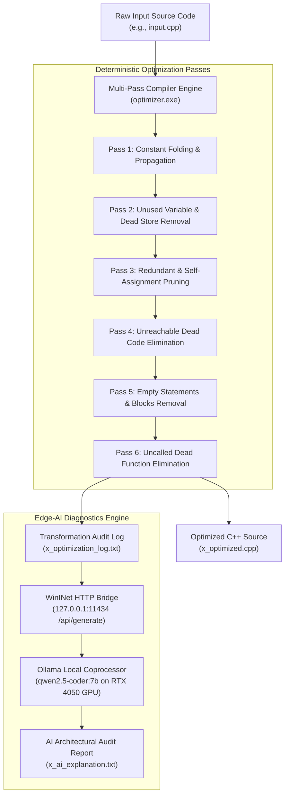

# ⚡ AI-Assisted Compiler Optimization & Code Transformation Engine
> **Sub-title**: Multi-Pass C++ Source-to-Source Optimizer with Local Edge-AI Diagnostics  
> **Target Architecture**: x86-64 / High-Level AST & IR  
> **AI Coprocessor**: Qwen 2.5 Coder 7B (Offline Inference on NVIDIA GeForce RTX 4050 GPU via CUDA)  
> **Platform**: Windows 11 / C++17 / WinINet HTTP API  

---

## 📋 1. Project Overview & Motivation

Modern industrial optimizing compilers (such as GCC `-O3` or Clang) optimize programs into low-level machine code via complex, opaque heuristics. However, they act as **black boxes**: developers, students, and engineers cannot easily inspect *what* transformations occurred, *why* they were safe, or *how* memory layout and CPU cycle counts were improved.

This project solves this by building a **Dual-Engine Optimizing Compiler**:
1. **Deterministic Optimization Engine**: A multi-pass C++ source rewriter that applies formal mathematical compiler transformations (Constant Folding, Constant Propagation, Dead Store Removal, Unreachable Code Elimination, and Dead Function Pruning).
2. **Local Edge-AI Diagnostic Coprocessor**: Directly integrates with a locally hosted LLM (`qwen2.5-coder:7b`) running on the developer's laptop GPU (RTX 4050) through native Windows WinINet HTTP calls, automatically generating an executive engineering report with performance, stack frame, and cache locality audits.

---

## 🏛️ 2. System Architecture



---

## 📂 3. Complete Source Code Function Reference (`main.cpp`)

Below is the complete reference of all functions, data structures, and line numbers in [`main.cpp`](./main.cpp):

| Function / Structure | Line Range | Category | Purpose & Technical Responsibility |
| :--- | :---: | :--- | :--- |
| `struct PassLog` | **Lines 16 - 23** | Data Structure | Stores recorded optimization events: line number, pass category, change description, rationale, hardware effect, and safety verification. |
| `trim()` | **Lines 26 - 31** | Helper Utility | Strips leading and trailing whitespace (` `, `\t`, `\r`, `\n`) for robust regex matching. |
| `stripComments()` | **Lines 34 - 58** | Helper Utility | Strips both single-line (`//`) and multi-line (`/* ... */`) comments while maintaining state across lines to prevent false variable matches. |
| `checkSideEffects()` | **Lines 61 - 81** | **Safety Guard** | Checks whether an expression contains function calls `()`, assignments `=`, increments `++`/`--`, or streams `<<`/`>>`. Guarantees statements with side-effects are never deleted. |
| `foldConstantExpression()` | **Lines 84 - 125** | Constant Arithmetic | Parses `<val1> <op> <val2>` using regex, computes the mathematical result at compile time (guarding against division by zero), and returns the string value. |
| `queryOllamaExplanation()` | **Lines 128 - 247** | **AI Coprocessor Bridge** | Connects to local Ollama API (`127.0.0.1:11434`) via native Windows `wininet.h`. Sends the transformation audit log, receives the streamed Markdown response from `qwen2.5-coder:7b`, and unescapes unicode characters. |
| `passConstantFoldAndPropagate()` | **Lines 250 - 376** | **Compiler Pass 1** | Identifies immutable constant variables, propagates their literal values into downstream expressions, and performs post-propagation constant arithmetic folding. |
| `passUnusedVariables()` | **Lines 379 - 429** | **Compiler Pass 2** | Identifies local variable declarations that have zero references across the translation unit and verifies side-effect safety before stripping them to save stack space. |
| `passRedundantAssignments()` | **Lines 432 - 522** | **Compiler Pass 3** | Detects self-assignments (e.g. `x = x;`) and dead assignments where a variable is assigned a value that is immediately overwritten without being read. |
| `passUnreachableCode()` | **Lines 525 - 573** | **Compiler Pass 4** | Scans control flow for unconditional `return` or `break` statements and eliminates all subsequent dead statements in the enclosing block scope. |
| `passEmptyStatementsAndBlocks()` | **Lines 576 - 608** | **Compiler Pass 5** | Cleans up stray semicolons (`;;`) and empty `{}` blocks. |
| `passUnusedFunctions()` | **Lines 611 - 666** | **Compiler Pass 6** | Analyzes the call graph across the file; any non-main function with zero invocations is pruned from the translation unit using brace-matching. |
| `main()` | **Lines 669 - 833** | **Compiler Driver** | Parses CLI args with dynamic file prefixing, loads source code, runs Passes 1–6, saves the optimized file, computes metrics, and invokes the AI Explainer. |

---

## 🔬 4. Detailed Breakdown of the 6 Optimization Passes

### Pass 1: Constant Folding & Propagation
* **Mechanism**: Detects statements like `int a = 9; int b = 13; int c = a + b;`.
* **Action**: Substitutes `a` with `9` and `b` with `13` (Propagation), then evaluates `9 + 13` at compile-time to produce `int c = 22;` (Folding).
* **Impact**: Eliminates runtime arithmetic ALU instructions and memory lookups.

### Pass 2: Dead Store & Unused Variable Removal
* **Mechanism**: Verifies that initializers are side-effect-free using `checkSideEffects()`.
* **Action**: Deletes declarations like `double dead_weight = 99.99;` and `string vedant = "lassi";`.
* **Impact**: Decreases stack frame size, reduces register spilling, and improves CPU L1 cache locality.

### Pass 3: Redundant & Self-Assignment Elimination
* **Mechanism**: Identifies no-op instructions like `x = x;` or back-to-back assignments to the same identifier.
* **Action**: Prunes redundant assignment statements.
* **Impact**: Saves CPU clock cycles by removing useless moves.

### Pass 4: Unreachable Dead Code Elimination
* **Mechanism**: Tracks return points. When an unconditional `return c;` occurs, all subsequent statements in that scope are flagged as dead.
* **Action**: Strips unreachable statements like `int shreyas = 30; return shreyas;`.
* **Impact**: Reduces executable binary size and prevents cache polluting by dead instruction bytes.

### Pass 5: Empty Statements & Blocks Removal
* **Mechanism**: Eliminates stray semicolons and empty curly brace `{}` blocks.
* **Impact**: Produces clean, readable output code and avoids generating no-op assembler labels.

### Pass 6: Dead Function Elimination
* **Mechanism**: Builds a symbol table of declared functions and checks for call references.
* **Action**: Any function (except `main`) with 0 callers is removed from the file.
* **Impact**: Reduces code footprint and symbol table size in the final binary.

---

## 🤖 5. Edge-AI Integration (Local Offline Inference)

* **Model**: `qwen2.5-coder:7b` (4-bit quantized, ~5.2 GB memory footprint).
* **Hardware Acceleration**: 82% GPU offload directly into **NVIDIA GeForce RTX 4050 Laptop GPU (6GB VRAM)** via CUDA.
* **Privacy & Security**: Zero cloud calls, zero API keys, 100% offline at `127.0.0.1:11434`.
* **Network Stack**: Native Windows WinINet API (`wininet.lib`) — no heavyweight third-party dependencies like `libcurl` or `boost`.

---

## 🚀 6. How to Run the Project

### Compilation
To compile the optimizer engine using MinGW-w64:
```powershell
cd "c:\Users\LOQ\Desktop\Compiler ISE final"
g++ -std=c++17 -Wall -Wextra main.cpp -o optimizer.exe -lwininet
```

### Running on Any C++ File
The optimizer automatically generates output files prefixed with the input file name:
```powershell
# Optimize any custom file (e.g., input.cpp or mycode.cpp):
.\optimizer.exe input.cpp
```

### Generated Output Files
Running on `input.cpp` generates:
1. **`input_optimized.cpp`**: The cleaned, transformed C++ source code.
2. **`input_optimization_log.txt`**: Detailed table of every pass and safety verification.
3. **`input_ai_explanation.txt`**: Markdown report written by `qwen2.5-coder:7b` analyzing the changes.

### Running the Complete Automated Test Suite
To execute all 6 automated test cases in sequence:
```powershell
.\run_all_tests.bat
```

---

## 🎓 7. Assessment & Viva Defense Guide

### Top Viva Questions & Professional Answers

#### Q1: What is the difference between Constant Folding and Constant Propagation?
> **Answer**: **Constant Propagation** replaces variable references with their known constant values (e.g. replacing variable `a` with `9`). **Constant Folding** is the compile-time mathematical evaluation of operations whose operands are constant literals (e.g. evaluating `9 + 13` to `22` at compile-time instead of running an `ADD` instruction at runtime).

#### Q2: How do you mathematically guarantee that optimizations do not break runtime behavior?
> **Answer**: Every optimization enforces **Strict Semantic Equivalence**. Before eliminating any unused variable, the compiler executes `checkSideEffects()`. If the initializer contains function calls (e.g., `int x = logEvent();`) or I/O operators, it is **never** deleted, preserving all external program state and observable behavior.

#### Q3: Why did you use a local LLM instead of OpenAI / Cloud API?
> **Answer**: In real-world enterprise software and compiler development, proprietary intellectual property (source code) cannot be transmitted across external third-party cloud networks. Running `qwen2.5-coder:7b` locally on an **NVIDIA RTX 4050 GPU** ensures zero data leakage, zero cloud latency, zero operating cost, and complete offline capability.

#### Q4: How is this project different from existing compilers like GCC `-O2`?
> **Answer**: GCC generates binary assembly directly and functions as a "black box" without exposing an accessible audit trail. Our system serves as an **educational and diagnostic source-to-source optimizer** that pairs formal deterministic transformation passes with generative AI to explain *why* each transformation occurred and its architectural implications.

